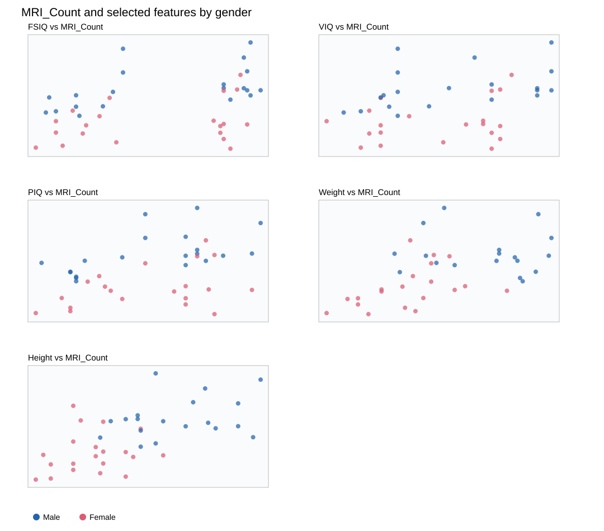
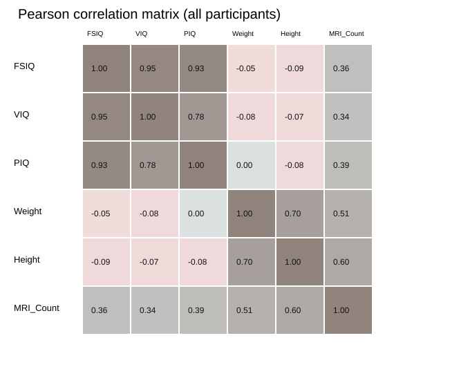

# Отчёт по лабораторной работе №2 — корреляционный анализ

## Данные и подготовка
Использованы файлы `titanic.csv` и `brainsize.txt`. Вторая таблица читается с разделителем TAB, обозначения `NA` интерпретируются как пропуски. Корреляции Пирсона рассчитываются попарно по доступным наблюдениям; пропущенные значения не заменяются нулями.

Исследуемые группы: женщины (20) и мужчины (20). Проверяются признаки FSIQ, VIQ, PIQ, Weight и Height относительно MRI_Count.

## Результаты корреляции

| Признак | Женщины (Pearson r) | Мужчины (Pearson r) |
|---|---:|---:|
| FSIQ | 0.3257 | 0.4984 |
| VIQ | 0.2549 | 0.4131 |
| PIQ | 0.3962 | 0.5682 |
| Weight | 0.4463 | -0.0769 |
| Height | 0.1745 | 0.3015 |

Корреляция не доказывает причинную связь. Малый размер групп и пропуски в антропометрических столбцах делают выводы чувствительными к отдельным наблюдениям.

## Диаграммы рассеяния по полу
На каждом графике представлены наблюдения мужчин и женщин в разных цветах. Графики строятся по исходным данным без заполнения пропусков.



## Тепловая карта корреляций



## Воспроизводимость
Исходный `plots.py` строит scatter-графики женщин и мужчин отдельно и тепловую карту через Matplotlib. Для просмотра графиков на локальном компьютере из корня репозитория:

```bash
python -m pip install pandas matplotlib pytest
python plots.py
python -m pytest -q
```

Встроенные SVG созданы на основе `brainsize.txt` и доступны непосредственно в GitHub. Функции `analyze_titanic` и `analyze_brain_correlations` находятся в отдельных Python-файлах и соответствуют интерфейсам преподавателя.
